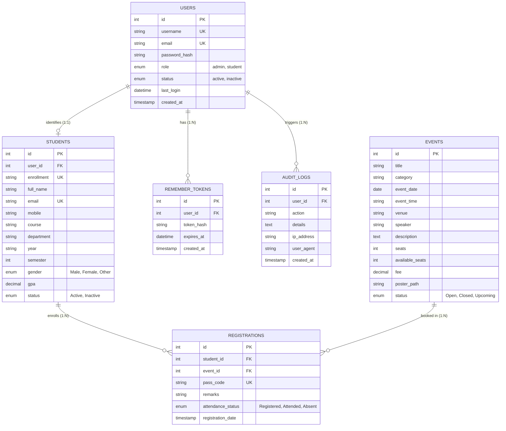

# StudentHub Database Schema & ER Model Documentation
**Subject:** Web Development Frameworks (ITUE203) &bull; Semester: 3rd (2026-27)  
**Institution:** Faculty of Technology and Engineering (FTE), CHARUSAT  
**Practicals Covered:** Practical 1 (Advanced), Practical 8 (Core & Intermediate), Practical 9, Practical 14  

---

## 1. Entity-Relationship (ER) Diagram

---

## 2. Data Dictionary & Relational Normalization (3NF)

### 2.1 Table: `users`
*Purpose:* Handles RBAC (Role-Based Access Control) authentication, secure password storage, and account status.

| Field | Type | Constraints | Description |
|---|---|---|---|
| `id` | INT | PRIMARY KEY, AUTO_INCREMENT | Unique user identifier |
| `username` | VARCHAR(50) | NOT NULL, UNIQUE | System handle (e.g. 23ce001) |
| `email` | VARCHAR(100) | NOT NULL, UNIQUE, INDEX | Login email address |
| `password_hash`| VARCHAR(255) | NOT NULL | Bcrypt hash generated via `password_hash()` |
| `role` | ENUM | NOT NULL DEFAULT 'student' | Access tier: `'admin'`, `'student'` |
| `status` | ENUM | NOT NULL DEFAULT 'active' | Account state: `'active'`, `'inactive'` |
| `last_login` | DATETIME | NULL | Timestamp of previous successful session |

### 2.2 Table: `students`
*Purpose:* Holds institutional records for engineering undergraduates across CSPIT and DEPSTAR.

| Field | Type | Constraints | Description |
|---|---|---|---|
| `id` | INT | PRIMARY KEY, AUTO_INCREMENT | Surrogate key |
| `user_id` | INT | FOREIGN KEY (`users.id`) | Foreign key linking user account |
| `enrollment` | VARCHAR(20) | NOT NULL, UNIQUE, INDEX | College Enrollment (e.g., 23CE001) |
| `full_name` | VARCHAR(100) | NOT NULL | Full name of the student |
| `course` | VARCHAR(80) | NOT NULL | Program (e.g. B.Tech Computer Engineering) |
| `department` | VARCHAR(50) | NOT NULL, INDEX | Department code (CSPIT-CE, DEPSTAR-IT) |
| `gpa` | DECIMAL(3,2)| DEFAULT 8.00 | Cumulative Grade Point Average |

### 2.3 Table: `events`
*Purpose:* Academic workshops, hackathons, and symposiums cataloged by coordinators.

| Field | Type | Constraints | Description |
|---|---|---|---|
| `id` | INT | PRIMARY KEY, AUTO_INCREMENT | Unique event identifier |
| `title` | VARCHAR(150)| NOT NULL | Workshop or competition title |
| `category` | VARCHAR(50) | NOT NULL, INDEX | Workshop, Hackathon, Competition, Robotics |
| `event_date` | DATE | NOT NULL, INDEX | Scheduled calendar date |
| `poster_path` | VARCHAR(255)| DEFAULT SVG path | Stored relative path to poster in `uploads/` |
| `status` | ENUM | NOT NULL DEFAULT 'Open' | `'Open'`, `'Closed'`, `'Upcoming'` |

### 2.4 Table: `registrations`
*Purpose:* Many-to-Many associative table mapping students to their chosen campus events with cryptographic pass codes.

| Field | Type | Constraints | Description |
|---|---|---|---|
| `id` | INT | PRIMARY KEY, AUTO_INCREMENT | Pass primary key |
| `student_id` | INT | FOREIGN KEY (`students.id`) | Enrolled student ID |
| `event_id` | INT | FOREIGN KEY (`events.id`) | Registered event ID |
| `pass_code` | VARCHAR(50) | NOT NULL, UNIQUE | Alpha-numeric digital entry pass |
| `attendance_status` | ENUM | DEFAULT 'Registered' | `'Registered'`, `'Attended'`, `'Absent'` |

---

## 3. Viva Preparation Questions & Answers (For B.Tech Examination)

**Q1: Why is `password_hash()` with `PASSWORD_BCRYPT` superior to `md5()` or `sha1()`?**  
*Answer:* MD5 and SHA-1 are fast hashing algorithms susceptible to rainbow table lookups and brute-force cracking. Bcrypt incorporates a cryptographic work factor (cost) and automatic salt generation, making offline brute-force attacks computationally infeasible.

**Q2: What is the purpose of `session_regenerate_id(true)` during login?**  
*Answer:* It mitigates Session Fixation attacks. By discarding the pre-authentication session ID and issuing a fresh cryptographic session token upon successful login, attackers who pre-seeded a session cookie cannot hijack the authenticated session.

**Q3: How does PDO prevent SQL Injection compared to direct queries?**  
*Answer:* PDO Prepared Statements separate the SQL query structure from user-supplied parameters. The database compiles the SQL template first, treating parameters strictly as literals regardless of quotes or escape sequences, neutralizing injection vectors.

**Q4: Explain the difference between Soft Delete and Hard Delete implemented in Practical 11.**  
*Answer:* Hard Delete permanently removes rows using `DELETE FROM`, causing potential referential integrity gaps or historical data loss. Soft Delete retains records while flipping a `status` column (e.g. `status = 'Inactive'`), preserving audit trails and referential links while filtering them out of active views.
